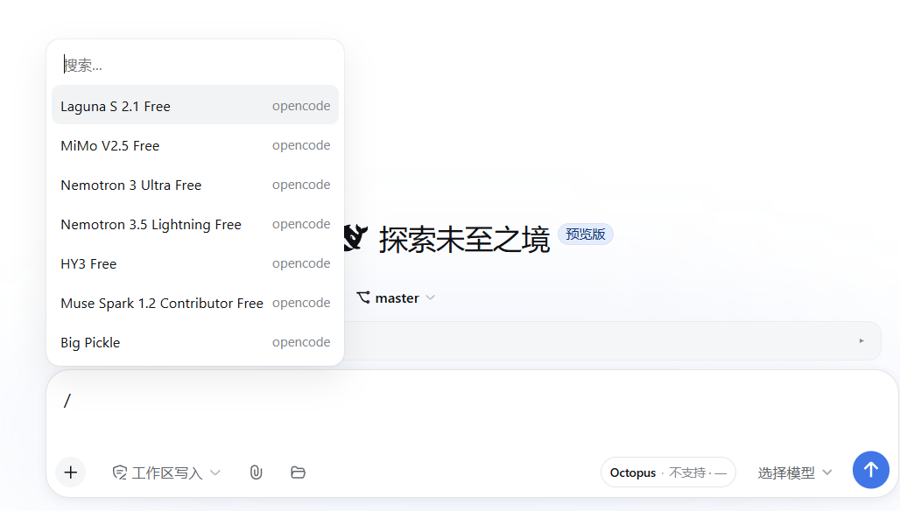
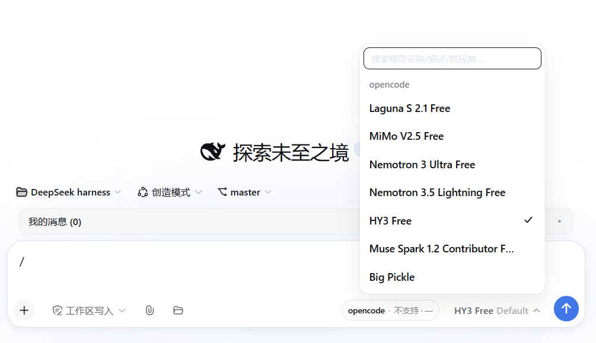
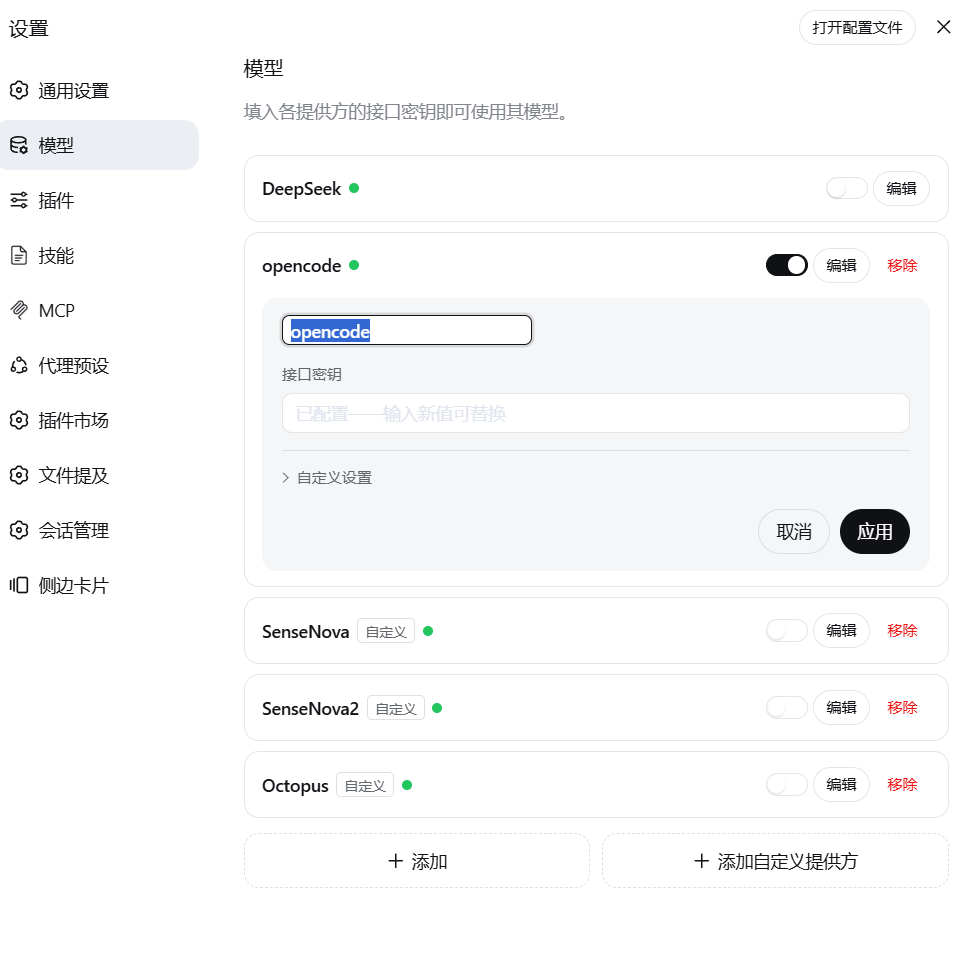

# DSH Provider Switch

DSH 静态插件（web profile）。在官方模型选择器基础上增加**供应商启停开关**、**模型搜索**和**供应商重命名**三个功能。

## 功能

1. **供应商启用/禁用** — 设置 → 模型页，每个供应商行前有开关。禁用后该供应商的模型从选择器中隐藏，且会话不会再调用其模型（直接报 `PROVIDER_DISABLED`，不重试）。官方「DeepSeek 账号」行（`deepseek-account`）自 v0.6.11 起同样有开关。
2. **模型搜索** — 输入框模型选择器顶部有搜索框，按模型名/描述/供应商名关键字过滤。
3. **供应商重命名** — 设置 → 模型页展开供应商编辑卡片后，点击卡片标题即可内联修改显示名。

## 效果预览

| 供应商启停开关 | 模型选择器 | 搜索过滤 |
|---|---|---|
|  |  |  |

## 前置条件

- **dsh web ≥ 0.1.7-rc.1**（`dsh --version` 查看）
- Node.js ≥ 20

## 安装

```bash
dsh plugin --profile web add github:zuojinxin/dsh-provider-switch
```

安装后重启 `dsh web` 即可。

## 验证

启动日志出现 `[provider-switch] settings namespace ready`，且设置 → 模型页每个供应商行前出现开关。

## 卸载

```bash
dsh plugin --profile web remove dsh-provider-switch
```

## 版本与 DSH 兼容性

| 插件版本 | 适配 DSH | 说明 |
|---|---|---|
| v0.6.11 | 0.2.1-rc.2 | 支持启用/禁用官方「DeepSeek 账号」行 |
| v0.6.10 | 0.2.1-rc.2 | 市场热挂载行自认领；settings 不可写时内存态降级 |
| v0.6.9 | 0.2.1-rc.2 | 修复流式输出时模型选择弹窗自动消失 |
| v0.6.5 | 0.1.7-rc.1 | 修复模型弹窗变灰+卡顿 |
| v0.6.2 | 0.1.7-rc.1 | 修复弹窗背景半透明 |
| v0.5.5 | 0.1.2-alpha.3 | 代码精简重构 |
| v0.4.0 | 0.1.0-rc | 初始稳定版 |

完整变更记录见 [CHANGELOG.md](CHANGELOG.md)。

## 文件

- `lib/index.js` — Host：settings 命名空间、`llm/stream` 拦截、HTTP 端点
- `lib/client.js` — Client：模型选择器 fork、设置页开关、重命名、样式
- `cordis.patch.yml` — 安装挂载层

## 已知限制

- 设置页开关和重命名基于 DOM 注入，DSH 升级改类名时可能消失（优雅降级，不影响其他功能）
- 禁用供应商只拦模型调用，不隐藏设置页里的供应商行
- 插件只拦 `llm/stream` waterfall，绕过该 waterfall 的直连调用不在拦截范围
- 「DeepSeek 账号」是账号态派生的伪供应商：禁用只拦它的模型调用，官方页面仍显示「已登录」；要彻底移除请到「账号与余额」登出

## 许可

MIT
