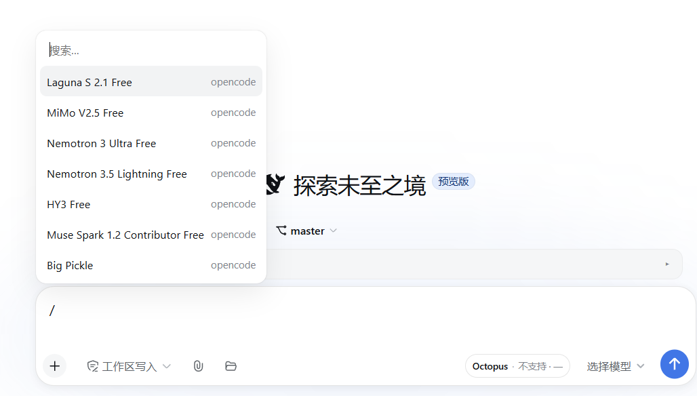
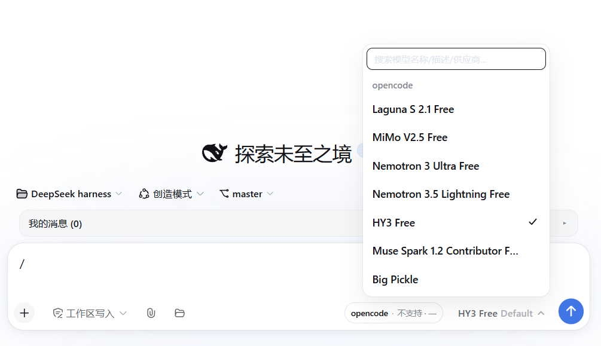
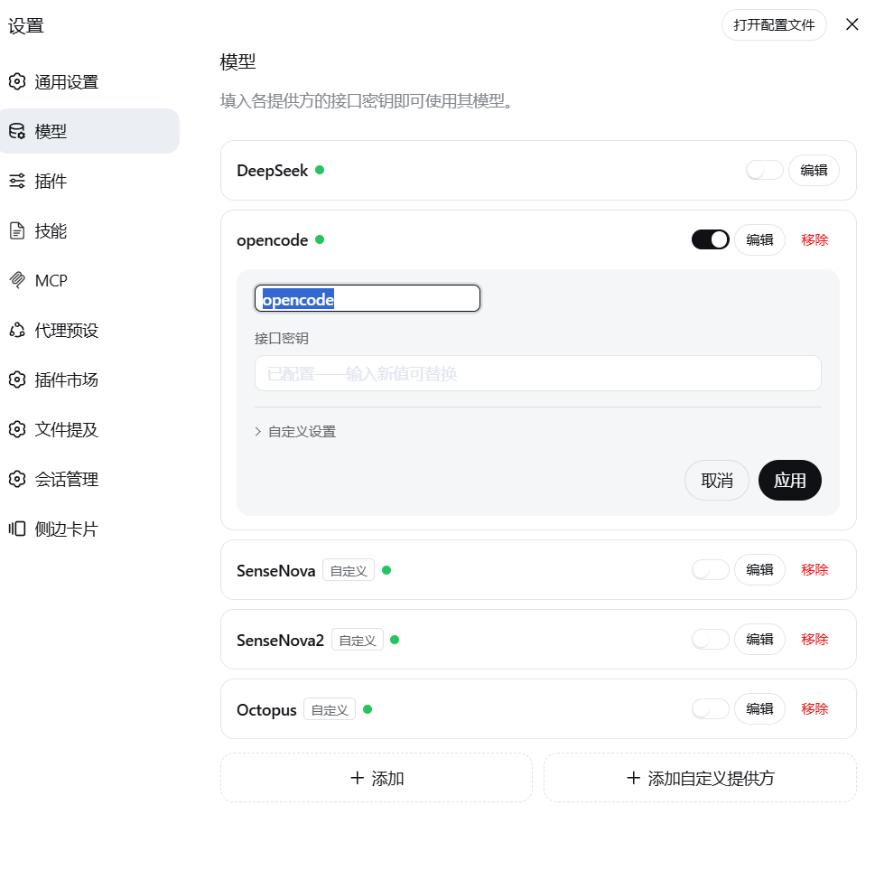

# DSH Provider Switch

[](https://github.com/deepseek-ai/deepseek-harness) [](./LICENSE) [](https://github.com/deepseek-ai/deepseek-harness)

为 DeepSeek Harness 的模型选择器加上**供应商启停开关**、**模型搜索**和**供应商重命名**。

## 功能

- **供应商启用 / 禁用** — 设置 → 模型页，每个供应商行前有开关。禁用后该供应商的模型从输入框选择器和 `/model` 弹层中隐藏，且会话不会再调用它的模型：`llm/stream` 被拦下并直接报 `PROVIDER_DISABLED`（403），不重试、不静默换供应商。
- **模型搜索** — 输入框模型选择器顶部有关键字搜索，同时匹配模型名、模型描述和供应商名，多个词按空格分开取交集。
- **供应商重命名** — 设置 → 模型页展开供应商编辑卡片后，点卡片标题即可内联改显示名；清空则回落到原始名称。
- **打开即定位** — 弹窗打开时直接滚到当前选中的模型，不用自己往下找。

<details>
<summary>静态界面预览</summary>







</details>

## 安装

```bash
dsh plugin --profile desktop add 'github:zuojinxin/dsh-provider-switch'
```

装完重启 DSH 桌面版生效。

## 验证

启动日志出现 `[provider-switch] own row "provider-switch" (persisted), disabled=[...]`，且设置 → 模型页每个供应商行前出现开关，即挂载成功。

开关状态持久化在 profile 的 `cordis.patch.yml`（命名空间 `provider-switch`）。如果日志里写的是 `memory only` 或 `not writable`，说明当前 profile 组合里这一行不可写，开关只在本进程内生效——重启即丢。

## 兼容性

面向 DeepSeek Harness 0.2.2-rc.1（桌面版实测）。插件按 `dsh.client` / `dsh.bundle.patch` 约定挂载，不依赖宿主的私有接口；宿主升级后若模型选择器的槽位名或设置页类名变化，会按下文「已知限制」里的方式降级，不会导致宿主报错。

## 卸载

```bash
dsh plugin --profile desktop remove dsh-provider-switch
```

## 文件

- `lib/index.js` — Host 侧：settings 命名空间读写、`llm/stream` 拦截、`/api/provider-switch` HTTP 端点
- `lib/client.js` — 浏览器侧：模型选择器（shadow 官方 `conversation.input.model` 槽位）、设置页开关、重命名、样式
- `cordis.patch.yml` — 安装挂载层，安装时由 DSH CLI 合并进 profile

## 已知限制

- **选择器是 shadow 接管，不是替换**。插件以 `priority: -1` 注册同一槽位，数据面刻意复用官方注册项自己的 `inject`：这样其他插件对官方模型列表的隐藏/投影仍然生效，本插件只在其上叠加禁用过滤。找不到官方注册项时回落直接读 `modelDirectories`，行为退化成「和官方一致 + 多一层过滤」。
- **开关和重命名基于 DOM 注入**。DSH 升级改类名时这两块会消失（静默降级，不影响模型选择器本身）。
- **禁用只拦模型调用**，不隐藏设置页里的供应商行，也不改供应商自身的登录态。
- **只拦 `llm/stream` waterfall**。绕过该 waterfall 的直连调用不在拦截范围内。
- **「DeepSeek 账号」是账号态派生的伪供应商**（provider id `deepseek-account`）。禁用只拦它的模型调用，官方页面仍显示「已登录」；要彻底移除请到「账号与余额」登出。
- **上游 provider 的目录加载失败会以横幅形式显示在选择器里**。文案由那个 provider 自己产生（例如 Jet Hub 的渠道凭据失效），本插件只负责原样渲染、并保证它不挤占模型列表的可滚动空间；要消掉横幅得去对应 provider 的设置页修凭据。

## 许可

MIT
